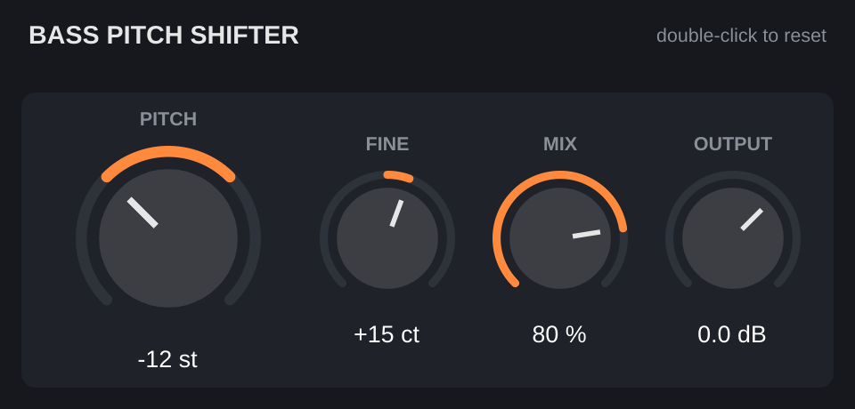

# Bass Pitch Shifter (VST3)

A minimal pitch-shifter plugin tuned for bass guitar and synth bass.



| Knob   | Range            | What it does                                     |
|--------|------------------|--------------------------------------------------|
| Pitch  | −24 … +12 st     | Shift in semitones (−12 = octave down)           |
| Fine   | −100 … +100 ct   | Fine tune in cents                               |
| Mix    | 0 … 100 %        | Dry/wet blend (dry is latency-aligned, no combing) |
| Output | −24 … +12 dB     | Output level                                     |

Double-click any knob to reset it.

## How it works

`Source/PitchShifter.h` is a phase vocoder with peak phase locking
(Laroche & Dolson, 1999):

- Long FFT (4096 samples at 44.1/48 kHz, scaled up at higher rates) with 8×
  overlap, so notes down to low B (~31 Hz) are resolved cleanly.
- Each spectral peak and its surrounding bins are moved as one block and
  rotated by a single phase, which keeps harmonics coherent and avoids the
  "phasey" sound of naive bin-by-bin shifting.
- The dry signal is delayed by the same latency so Mix blends in phase.

**Latency:** 3584 samples (~75 ms at 48 kHz), reported to the host so it is
compensated on playback. That's fine for mixing/recording, but noticeable if
you monitor live through it.

## Building

Requires CMake ≥ 3.22 and a C++17 compiler. JUCE 8 is downloaded automatically.

```bash
cmake -S . -B build -DCMAKE_BUILD_TYPE=Release
cmake --build build --config Release
```

The plugin ends up in `build/BassPitchShifter_artefacts/Release/VST3/Bass Pitch Shifter.vst3`.
Copy it to your VST3 folder:

- **Windows:** `C:\Program Files\Common Files\VST3\`
- **macOS:** `~/Library/Audio/Plug-Ins/VST3/`
- **Linux:** `~/.vst3/`

On Linux you'll need: `libasound2-dev libx11-dev libxrandr-dev libxinerama-dev
libxcursor-dev libxcomposite-dev libfreetype6-dev libfontconfig1-dev`.

Prebuilt Windows/macOS/Linux builds are produced by GitHub Actions on every
push (Actions tab → latest run → Artifacts).

### DSP test

`build/DspTest_artefacts/Release/DspTest` runs bass sine waves through the
shifter at several sample rates/intervals and checks the output pitch (within
5 cents) and level.
